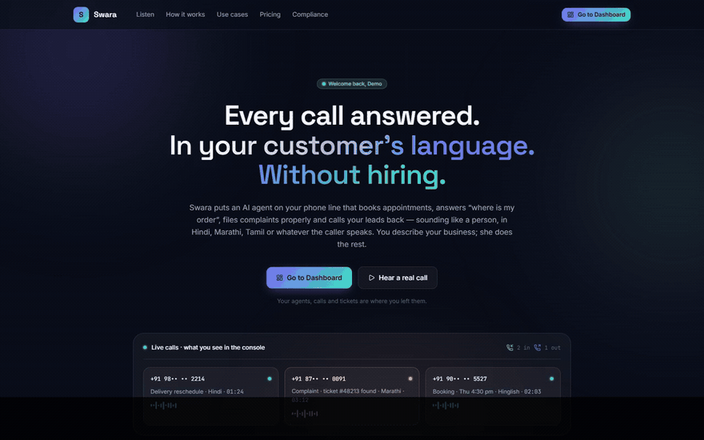
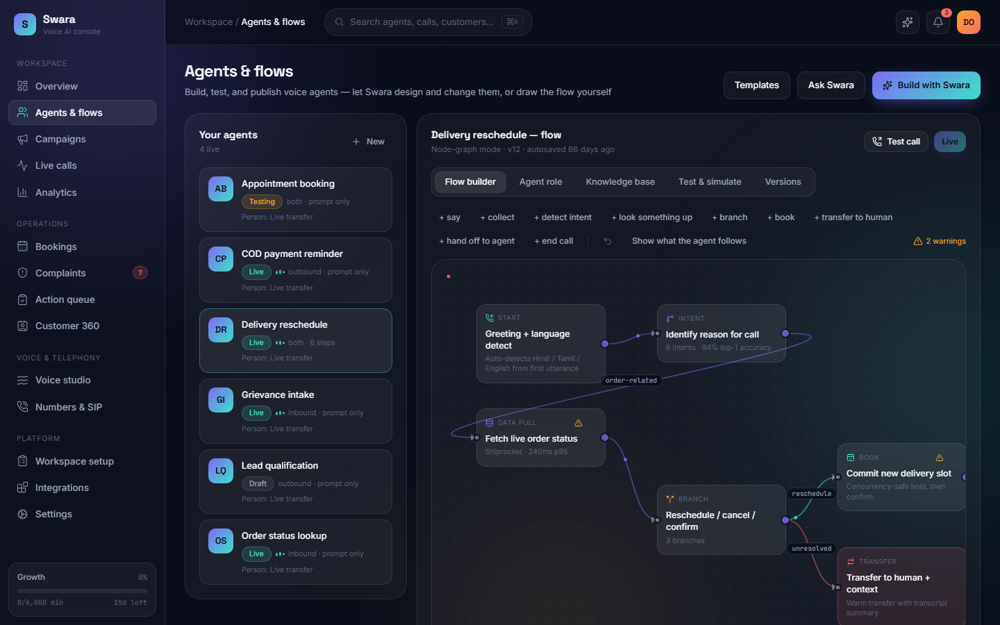
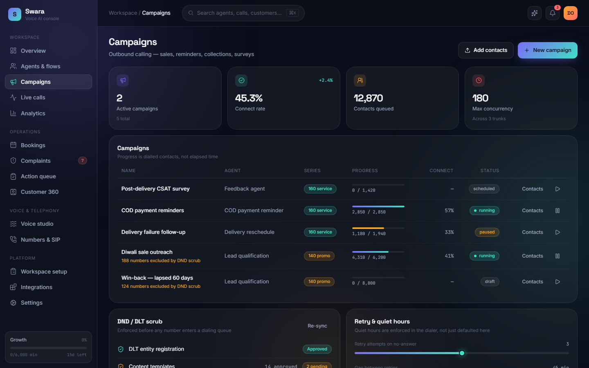
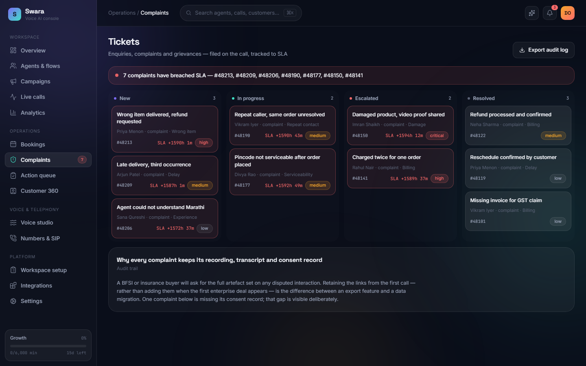
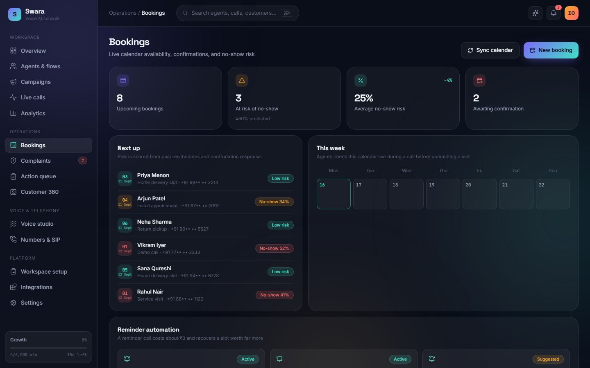
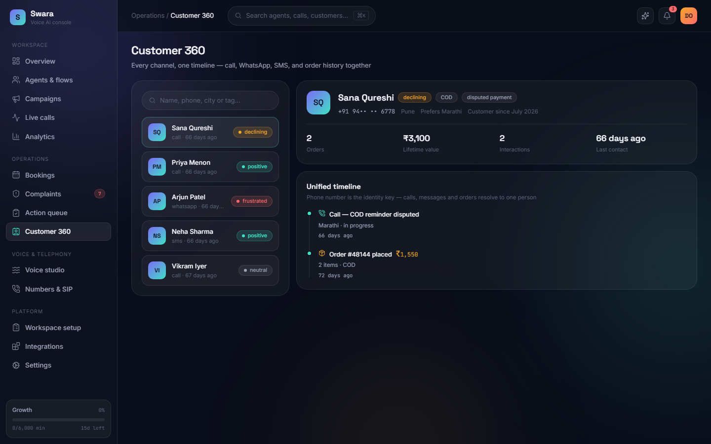
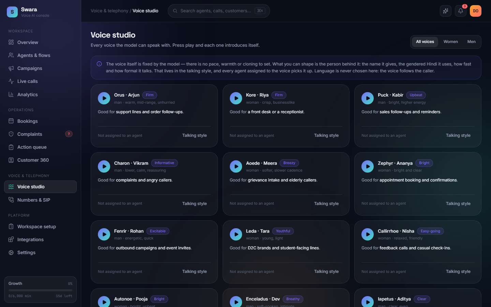
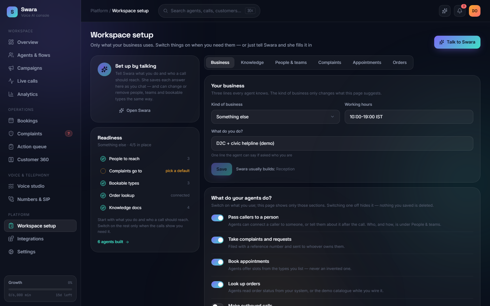

# Swara

An AI voice agent for Indian businesses. It picks up the phone, speaks the caller’s language, and does the job on the call — a booking, an order update, a complaint, a reminder — then leaves a record a person can actually use.

One product covers inbound and outbound. You describe the business. Swara writes the agents. You publish them onto a number and watch the calls.

## A 30-second look



[Open the sharper video (mp4)](docs/readme/walkthrough.mp4)

## What it does

**Answers in the caller’s language.** Hindi, English, Hinglish, Marathi, Tamil, Telugu, Kannada, Malayalam, Bengali, Gujarati, Punjabi, and Odia. The agent follows the caller, including a switch mid-sentence. Nobody presses 1 for Hindi.

**Sounds like a person on a phone line.** Short sentences, room for a pause, and it does not talk over someone who is thinking in two languages.

**Does the work while the caller is still on the line.** Look up an order. File a ticket and read back a real reference number. Book a slot. Search the company’s own notes. Hand the call to another agent, or to a person, with the context already written down. Hang up only after the caller is done.

**Builds the agents with you.** Swara interviews the owner — what the business does, who should be called, what can be booked — and proposes a set of agents. “Build with Swara” turns that plan into call flows. You can also draw the flow yourself, edit the role, attach knowledge, and place a test call before anything goes live.

**Runs the operation, not just the call.**

- Campaigns for reminders, follow-ups, and outreach, with DND scrubbing and quiet hours
- A live wall to listen, take over, or transfer
- A ticket board with severity and an SLA clock
- Bookings, with a no-show risk on each one
- One timeline per customer across calls, messages, and orders
- A voice for each job — a calm one for complaints, a brighter one for reminders
- Cost of each call, visible in the console

### Call flows

Each agent is a flow: greet and detect language, pull the order, branch, book, or hand the call to a person.



### Outbound

Sales, payment reminders, and surveys from the same agents that answer inbound. Promotional and service numbers stay distinct, and numbers on the DND list are dropped before they are dialled.



### Complaints

A ticket filed on the call shows up on the board with a reference, a severity, and a countdown. The recording, transcript, and consent stay attached.



### Bookings

The agent offers a real slot and confirms it on the call. Repeat no-shows are flagged before the next appointment.



### The customer, in one place

Calls, WhatsApp, SMS, and orders sit on one timeline, so the agent already knows the last conversation.



### Voices

The model’s voices, cast as people the business can assign: Riya for a front desk, Vikram for an angry caller, Kabir for a reminder.



### Setup, by talking

Tell Swara the hours, the people, and what a call should be able to do. She fills the workspace. The switches decide which parts of the product that business actually needs.



## Technology

Built as one product: the console, the voice session, and the phone bridge.

| | |
|---|---|
| Voice | **Gemini 3.8 Live** — speech in, speech out. No separate speech-to-text and text-to-speech chain. |
| Setup, planning, and call review | **Gemini 3.5 Flash**, with **Gemini 3.5 Flash-Lite** as the fallback. Swara’s interview, the agent plan, summaries, and call scoring. |
| Voices | Gemini’s prebuilt voices, shaped into personas (Kore / Riya, Orus / Arjun, Charon / Vikram, Puck / Kabir, Aoede / Meera, and the rest of the catalog). |
| On the call | The model calls tools itself: orders, tickets, bookings, knowledge search, transfer, handoff between agents, hangup. The tools run on the server. |
| App | **Next.js 16**, **React 19**, TypeScript, Tailwind CSS 4. |
| Data | SQLite, with Zod on every response and TanStack Query in the console. |
| Phone network | **Plivo**, through a Python audio bridge: inbound by number, outbound and campaigns, answering-machine detection, live listen and takeover, recording, and spoken consent. |
| Around the call | WhatsApp and SMS via Plivo, email via Resend, invoices via Razorpay — each optional. |

The pause detection is tuned for Indian phone calls. People switch between Hindi and English mid-sentence and leave a gap. The agent waits through that gap instead of cutting in.

Long calls keep their place. The session compresses older audio so a grievance call can run past the point where a raw audio session would forget the beginning. The caller’s transcript and the agent’s transcript are both kept, for the ticket and for whoever takes the call over.

## Run it

The console ships with a demo workspace.

```bash
cd web
cp .env.example .env.local
npm install
npm run dev
```

Open [http://localhost:3000](http://localhost:3000) and sign in as `demo@swara.in` / `swara-demo`.

Add `GEMINI_API_KEY` to `web/.env.local` and use **Test call** on an agent to talk to it in the browser. Real phone calls need a Plivo account and the bridge in `telephony/` — see [docs/telephony.md](docs/telephony.md).

Deeper notes, if you want them: [the console](web/README.md), [the voice session](docs/live-api.md), [the phone bridge](docs/telephony.md).
